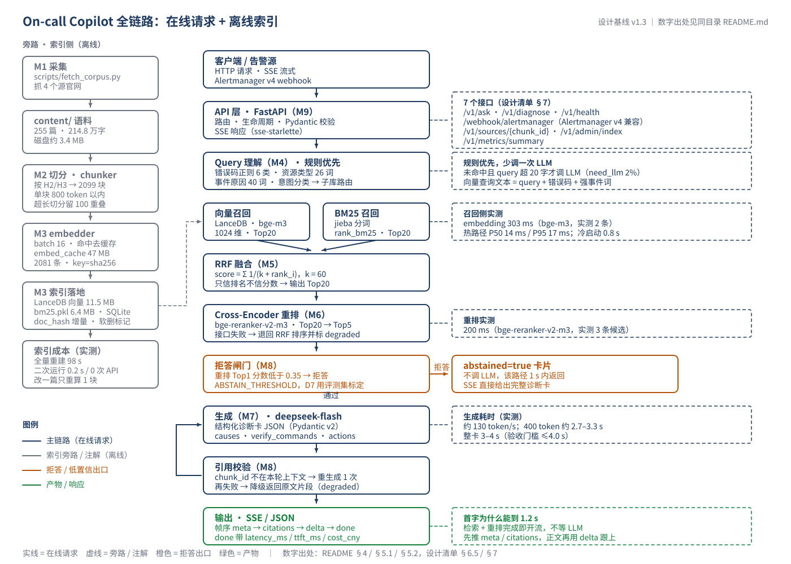

# On-call Copilot · 面试讲解手册

> 用途：面试前 30 分钟过一遍；面试时按「三档口述 → 图 → 逐层原理 → 取舍 → 追问」的顺序讲。
> 原则：**只讲真跑过的**。标「实测」的数字来自可重跑脚本；标「设计」的是清单里的目标、还没实现；标「待标定」的是明确没做实验的，别当场吹。

---

## 0. 材料索引

| 文件 | 内容 | 面试用在哪 |
|---|---|---|
| 本文件 | 口述脚本 + 原理 + 追问答 | 主线 |
| [oncall-flow.svg](diagrams/oncall-flow.svg) | 全链路图（矢量，可放大投屏） | 白板/投屏讲流程 |
| [diagrams/README.md](diagrams/README.md) | 图的读法、每个节点的实测耗时标注 | 讲图时的旁注 |
| [refs/技术栈参考链接.md](refs/技术栈参考链接.md) | 30 项官方文档链接（逐条验证可访问） | 被问到「原理出处」时给定点 |
| [../README.md](../README.md) | 项目自述：技术栈、实测、已知缺陷 | 面试前甩给对方看 |
| ../技术路线与设计清单.md | v1.3 设计定稿（636 行，M0-M11 模块级） | 证明「先设计后实现」 |

---

## 1. 三档口述（背这一份就够）

### 1.1 三十秒（自我介绍里带出来）

> 我做了一个 On-call Copilot：把值班时那句「线上出事了」变成一张**带引用的结构化诊断卡**。
> 链路是 Query 理解 → 向量 + BM25 双路召回 → RRF 融合 → Cross-Encoder 重排 Top5 → LLM 生成 JSON 诊断卡 → **引用后校验 + 拒答** → SSE 流式推回。
> 全 API 化，本机不装任何模型，255 篇公开运维文档、2099 个 chunk，检索层单测和评测探针都跑过。

### 1.2 两分钟（讲「为什么这么做」，不讲实现细节）

> 起因很具体：线上故障的第一步不是「没有答案」，是**答案埋在几百万字文档里，值班的人没时间翻**，而直接把日志丢给大模型，它会给你一段很像真的、但**没有出处**的处置步骤——这在生产上比没有答案更危险。
>
> 所以我把问题拆成三个可验证的子问题：
>
> **第一，别漏。** 单路向量召回会漏掉 OOMKilled、exit code 137 这种精确 token，语义模型把它们压成一个「模糊的容器错误」；反过来纯 BM25 又扛不住「Pod 一直起不来」这种没有关键词的口语描述。所以两路各取 Top20，用 RRF 只按排名融合——余弦相似度和 BM25 分数量纲根本不可比，加权是自欺欺人。
>
> **第二，别错。** 融合后的 20 条用 Cross-Encoder 重排：它把 query 和文档拼在一起过一遍模型，能吃到「这个词在这句话里」的交互信息，比双塔的点积准得多，代价是每条都要一次前向，所以只在 20 条上做。
>
> **第三，别编。** 生成侧强制 JSON + Pydantic，每条结论必须带 [chunk_id]；生成完再**后置校验一遍**，chunk_id 不在本次上下文里就丢弃重生成，再不通过就降级返回原文片段。拒答是双保险：重排 Top1 低于阈值直接不进 LLM，引用全落空也拒。
>
> 工程上：FastAPI 起服务、SQLite 存元数据、LanceDB 嵌入式向量库、rank_bm25 + jieba 做中文 BM25，embedding / rerank / LLM 三件套全走 HTTP，本机零模型。SSE 先把检索结果和引用推出去，正文再流式到达，首字不用等生成完。
>
> 目前 M0-M5 落地并实测：2099 块索引、全量重建 98 秒、二次运行 0 次 API 调用 0.2 秒；50 条真实报错文本上 Query 理解的资源类型抽取 50/50，只有 2% 需要回落 LLM。

### 1.3 五分钟（上面的骨架 + 三个「我被什么打过脸」）

两分钟版本讲完，补三段**踩坑故事**，这是最能证明「你真做过」的部分：

1. **中文 BM25 不分词等于没做**：第一版直接把整段文本丢给 rank_bm25，OOMKilled、exit 137 这些 token 全被当成一个长串，IDF 算出来是垃圾。改成「先小写归一、再 jieba 精确模式、只留字母数字汉字」之后，英文连续字母串（oomkilled）保持整词、137 独立成 token、中文按词切，精确 token 的 IDF 才有意义。
2. **切分不是定长滑窗**：第一版按 500 字硬切，标题和内容被切成两半，检索出来的块单看根本不知道在讲哪个资源。改成按 H2/H3 开新节 + 节内贪心装填（≤800 token）+ 溢出时回取 100 token 重叠，每块带 heading_path，才满足「单独看这块能自洽」。
3. **P95 ≤ 2.0s 是我自己写进清单、又被实测打死的指标**：deepseek-flash 生成 400 token 实测 2.7-3.3 秒（约 130 token/s），叠上检索和重排，非流式就是 4 秒上下（D4 九次实测 P50 4.48 s）。我没有去改口径让它好看，而是把验收拆成两段——**SSE 首 token ≤1.2 s（主口径）、整卡 P50 ≤4.5 s / P95 ≤8 s**——并在 README 里写明根因是模型自写长度、不承诺 2 s 也不承诺 4 s（D4 首批 9 次 P50 4480 ms、P95 7089 ms；收尾复跑后三批 27 次合计 P50 4346 ms、P95 8003 ms、最慢 8306 ms，2 次破线——所以标准说法是「P50 稳、P95 贴线未稳」）。面试官问到延迟，这个回答比「我们 P95 是 1.x 秒」可信得多。

---

## 2. 全链路图

读图顺序（讲的时候按这个走，别从左到右平铺）：

1. **上半条是查询路径（在线）**：报错文本进来 → Query 理解出 QueryPlan → 双路召回各 Top20 → RRF → 重排 Top5 → 生成 → 校验/拒答 → SSE。
2. **下半条是索引路径（离线）**：抓取 → 清洗成 Markdown → 按标题切分 → embedding 批量 + 缓存 → LanceDB + BM25 双写。
3. **两条路径只在「chunk 的表示」这一点上耦合**：切分口径变了，索引和查询都要重建——这也是为什么 chunk 参数要写进配置，而不是散落在代码里。

> 讲图时的边界：重排（M6）、生成（M7）、引用校验与拒答（M8）**已在 D4 落地**（`app/core/reranker.py`、`generator.py`、`guard.py`、`pipeline.py`，142 个单测，`scripts/d4_e2e.py` 能跑通整链）；还没落地的是 **M9 的 FastAPI 路由层**（SSE / webhook / admin）与 M11 的 query_log。讲图时可以说「pipeline 已跑通、9 次真实调用」，不要说「接口已经对外可用」。

内联简化版（白板手画用这个）：

    报错文本 / Alertmanager 告警
        |
        v
    [Query 理解]  正则 6 类(exit code \d+ / 0/N nodes are available) + 词典(资源类型 26 词 / 事件原因 40 词)
        |        未命中且 query>20 字 -> 才调 LLM 分类
        v
    [双路召回]  LanceDB 向量 Top20  ||  rank_bm25(jieba) Top20
        |            \                  /
        |             [RRF 融合]  score = Σ 1/(60 + rank)
        v
    [Cross-Encoder 重排]  bge-reranker-v2-m3, 20 -> 5
        |
        +--- Top1 分数 < ABSTAIN_THRESHOLD ---> 直接拒答（不调 LLM，<1s）
        v
    [生成]  deepseek-flash, JSON mode -> Pydantic 校验（失败重试 1 次 -> 降级纯文本）
        v
    [引用后校验]  每条 evidence.chunk_id 必须 ∈ 本次上下文
        |        不通过 -> 丢弃重生成 1 次 -> 再失败降级返回原文片段
        v
    [SSE]  meta -> citations -> delta -> done(latency_ms / ttft_ms / cost_cny)

---

## 3. 技术栈总表（被问「为什么用这个」时按行答）

| # | 层 | 选型 | 它到底干什么 | 为什么是它（面试一句话） | 实测 / 事实 | 追问风险 |
|---|---|---|---|---|---|---|
| 1 | Web | FastAPI + uvicorn | 异步 HTTP 服务、自动 OpenAPI | 原生 async，SSE 用 StreamingResponse 就够，不引框架 | 单进程承载 7 个接口设计 | 没上多 worker：LanceDB 写锁 + BM25 内存索引不适合多进程写 |
| 2 | 契约 | Pydantic v2 | 请求 / 诊断卡模型 + 校验 | 诊断卡是**可机读产物**，不是自由文本 | 生成侧校验失败会重试 1 次 | v2 的 validator 语义与 v1 不同，别说成 v1 |
| 3 | 流式 | sse-starlette | 按 SSE 协议发事件 | 自己写 chunked 流容易漏 keep-alive 和断连处理 | 帧序 meta→citations→delta→done | SSE 是单向的，别吹成 WebSocket |
| 4 | 元数据 | SQLite | 文档状态表 / query_log | 零安装零运维，单人项目不引 PG | 二次索引 0.2 s 判定 | 并发写弱：单机够用，生产换 PG |
| 5 | 向量库 | LanceDB（嵌入式） | 存 1024 维向量 + 元数据过滤 | 无服务进程、磁盘持久化、Windows 友好；pgvector 要装 PG | 2099 × 1024 float32 ≈ 8.6 MB，暴力扫描毫秒级 | 上万块以后才需要 ANN，当前不需要，别装懂 |
| 6 | Embedding | 硅基流动 BAAI/bge-m3 | query / doc → 1024 维向量 | 中英混排强（语料中英混杂），本机不装模型 | 实测 dim=1024、L2=1.000、2 条约 303 ms | 免费额度只用于公开语料；限速要退避 |
| 7 | 关键词 | rank_bm25 + jieba | 稀疏检索（精确 token 召回） | 中文不分词 BM25 直接废；jieba 保留 OOMKilled / exit 137 | BM25 只吃词，不懂语义 | 纯 Python 实现，全量重建时是 CPU 热点 |
| 8 | 融合 | RRF（k=60） | 两路排名合并 | 余弦与 BM25 分数量纲不可比，**只信排名** | 免调权重，对单路噪声鲁棒 | k 越小头部权重越大；k=60 是原论文经验值 |
| 9 | 重排 | 硅基流动 bge-reranker-v2-m3 | 20 → 5，交叉编码打分 | 同系列 cross-encoder，免 1.1 GB 本地权重 | 实测 200 ms / 3 条候选；相关 0.5587、无关 0.0000 | 不是 OpenAI 标准接口，是 POST /v1/rerank；分数不是概率 |
| 10 | 生成 | DeepSeek deepseek-flash | 依据上下文出 JSON 诊断卡 | 中文技术语义强、JSON mode 稳、便宜 | 400 tok 实测 2702 / 3255 / 3286 ms ≈130 tok/s | 该账号 deepseek-chat 是 flash 的别名，配置里写死 flash |
| 11 | 韧性 | tenacity | 外部调用重试 / 退避 | 外部 API 必须假设会抖 | 指数退避 + 上限次数 | 重试要防重复计费，生成只重试 1 次 |
| 12 | 日志 | loguru + SQLite query_log | 请求级可观测 | 每个请求落一行，成本/延迟可回溯 | query_log 含 latency / tokens / cost | 没接 Prometheus，metrics 接口够用 |
| 13 | 配置 | pydantic-settings + .env | 配置与密钥分离 | 密钥不进代码、不进 git | 密钥在项目外目录，用 ONCALL_ENV_FILE 指过去 | 别说成「用了 Vault」 |
| 14 | 测试 | pytest | 检索层单测 | 切分 / 检索 / Query 理解最容易静默错 | 35 个单测通过 | 沙箱里 tmp_path 有坑，skipped 1 个 |
| 15 | 不用 | LangChain / LlamaIndex | — | 黑盒、层层封装，本项目链路只有 6 步 | 全手写约 200 行 | 被问「为什么不用」见 §6 Q1 |

---

## 4. 逐层原理（面试官要的是「为什么有效」，不是「调了哪个函数」）

### 4.1 RAG 的失效模式与本项目的对策（先给总纲）

| 失效模式 | 典型症状 | 本项目的对策 | 我在哪验证过 |
|---|---|---|---|
| 漏召回 | 精确 token 的文档没进 Top20 | BM25 补稀疏路 | 12 条探针：子库过滤后 recall@20 = 12/12 |
| 召回不精 | 语义相近但答非所问的块排前面 | Cross-Encoder 重排 | 已实现（M6，reranker.py） |
| 切分破坏语义 | 块里没有主谓宾，单看不知所云 | H2/H3 结构切分 + heading_path | 2099 块，0 超限 |
| 幻觉 | 说得像真的但文档里没有 | 强制 chunk_id + 后置校验 | 已实现（M8，guard.py 白名单校验） |
| 没有答案硬答 | 语料里根本没这条故障 | 双保险拒答 | 已实现（M8，阈值 0.35 仍是初值，待 D7 标定） |
| 首字慢 | 值班人 3 秒就跑了 | SSE 先推 meta / citations | 设计（D5 未实现） |

> 讲这张表的好处：它把「你做了什么」升级成「你针对哪一类问题做了什么」，面试官会顺着问，而往下每一条你都有答案。

### 4.2 切分：为什么按标题，不按定长

定长滑窗的问题不是「切碎了」，是**切出的块缺少主题锚点**：一块里前半段讲 Pending、后半段讲 OOMKilled，向量被拉成两个主题的平均值，两边的查询都不靠前。

做法（app/index/chunker.py）：

    H2/H3 标题开新节
      └─ 节内按「原子块」贪心装填：段落 / 代码块 / 列表项 都是不可再分的单位
           ├─ 单块 ≤ 800 tokens（CJK 1 字 ≈ 1 token，其余 ceil(n/4) 估）
           ├─ 装不下就回取 ≤100 token 的重叠（重叠的是整块，不是字符）
           └─ 落单的小块（<30 token）并入前一块
    每个块带 heading_path，例如：探针失败排查 > Pod 处于 Pending > 资源不足

三个取舍：

- **800 token 上限**不是拍的：上下文要放 5 个块 + prompt + 输出，800×5 已 4000 token，再大就挤占生成预算、也降低引用精确度。
- **100 token 重叠**只为救跨块边界的因果句（前半句在上一块）。重叠太大等于同一事实被多块重复召回，RRF 会把同源块刷屏。
- **代码块不许拆**：K8s / Nginx 的排障步骤大量是命令 + 输出，拆开就废；超长代码块按行切且每片重新包住围栏。

实测：255 篇 → 2099 块（8.2 块/篇），最长 794 token，0 个超限块。**块数不是按「token 总量 ÷ 800」算的**：那样算出 917 是理论下限，实际由标题密度决定（k8s 的 H2/H3 极密，均块只有 349 token）。设计清单 v1.4 已把目标改成 1800-2200，实测 2099 落在区间内；要更细粒度把 `MAX_TOKENS` 降到 600（约 2600-2800 块），代价是小块更多、同节上下文更碎，得重跑评测再定。

### 4.3 向量召回：双塔 + 余弦

    doc   ──encoder──> v_d ∈ R^1024
    query ──encoder──> v_q ∈ R^1024
    sim = cos(v_q, v_d) = (v_q · v_d) / (|v_q| |v_d|)

bge-m3 输出已 L2 归一化（实测 |v|=1.000），所以余弦 = 点积；LanceDB 用 cosine 距离 = 1 − cos，越小越近。

**这是双塔（bi-encoder）：query 和 doc 各自独立编码，编码时互相看不见。** 好处是 doc 向量可以离线算好、在线只算 query（303 ms 里大部分是网络往返）；代价是「query 里某个词和 doc 里某个词是否呼应」这层交互只能靠向量空间近似。

工程细节：

- **向量查询文本不是原始 query**：等于 原 query + 抽出的错误码 + 事件原因。因为 OOMKilled 这种 token 只在长句里出现一次会被稀释，拼进去能提高它的贡献。
- **元数据过滤先于向量搜索**：QueryPlan 命中资源类型时按 source 过滤子库（向量路走 LanceDB 的 where，BM25 路按 source 过滤）。探针实测：过滤 12/12、不过滤 11/12（唯一的漏是 Redis connection refused 被 K8s 文档挤掉）——这是「子库过滤不是锦上添花」的直接证据。
- **过滤只提精度，不能牺牲召回**：子库过滤后若结果不足 limit，会补跑一次不限源召回、两批共 4 路重新 RRF（rrf_fuse(vec, bm, vec_all, bm_all)），并置 fallback 标记。这一步是我实现时自己加的——纯过滤会让「资源类型判对、但答案写在另一类文档里」的查询直接空手。

### 4.4 BM25：为什么混合检索不是「多加一个库」

BM25 是稀疏检索的经典打分（rank_bm25.BM25Okapi 默认 k1=1.5、b=0.75）：

    score(q,d) = Σ_i IDF(q_i) · [ f(q_i,d)·(k1+1) ] / [ f(q_i,d) + k1·(1 − b + b·|d|/avgdl) ]

三个部分各管一件事：

- **IDF**：稀有词权重大。OOMKilled 在 255 篇里只出现几十次，权重天然高；「集群」「配置」到处都有，权重接近 0。
- **f / (f + …)**：词频饱和——出现 10 次不比出现 3 次强多少，防止复读机文档霸榜。
- **b 项**：长度归一化，长文档不会因为「词多」白占便宜。

**为什么中文必须分词**：rank_bm25 收到的 token 列表就是它的原子单位。不分词 = 整句一个 token，所有查询都对不上；jieba 切词后中文按词、英文连续字母串（OOMKilled、exit 137 里的 137）各自成 token，精确 token 的 IDF 才有意义。

向量与 BM25 的互补不是玄学，是**两种表示**：

| | 向量 | BM25 |
|---|---|---|
| 匹配的是什么 | 语义（同义、改写、跨语言） | 字面（精确 token、错误码、命令名） |
| 怕什么 | 精确 token 被语义「平均」掉 | 换个说法就完全匹配不上 |
| 本项目的例子 | 「Pod 一直起不来」→ 命中 Pending / OOM 语义块 | 「exit code 137」→ 精确命中 OOMKilled 段 |

### 4.5 RRF：为什么不用加权求和

两路分数量纲不可比：余弦在 [−1,1]（本语料实测大多 0.4-0.7），BM25 可以到 30+，而且随语料规模漂移。归一化（min-max / z-score）能硬凑，但每次语料变化分布就变，等于每改一次语料重调一次权重。

RRF 只看排名：

    score(d) = Σ_{r ∈ 各路} 1 / (k + rank_r(d))      k = 60

性质：

- 两路都进 Top20 的文档约 2/61 ≈ 0.0328；只被一路排第 1 的约 1/61 ≈ 0.0164 → **共识优先**。
- k 控制头部陡峭度：k 小则第 1 名远高于第 10 名（激进），k 大则排名差异被抹平（保守）。k=60 是原论文经验值，我没调——**这个诚实点可以说：本规模下 RRF 的收益主要在「稳」，不在「最优」**。
- 代价：两路都弱时（语料里压根没有），RRF 也分不出强弱，只能靠拒答兜底。

### 4.6 Cross-Encoder 重排：20 → 5 这一步为什么值

    [CLS] query [SEP] doc [SEP] ──Transformer──> 一个分数

- **双塔**：query、doc 分开编码再点积，doc 向量可复用，但交互信息在编码时就丢了。
- **交叉编码**：query 和 doc 拼成一条序列过一次模型，每一层注意力都能让 query 的 token 直接看见 doc 的 token（「Pending」看见「Insufficient memory」），所以对「这一段到底答没答这个问题」判断准得多。
- 代价：**每条候选一次前向**，不能预计算。20 条就是 20 次（服务端 batch 处理，实测单次调用 200 ms 量级）→ 所以只重排 Top20，不重排全库。

工程上必须有的两件事：

1. **降级**：rerank API 挂了就退回 RRF 顺序并打 degraded 标记，评测报告单列——否则一次 502 就让整个服务不可用。
2. **分数不能当概率**：实测相关 0.5587、无关 0.0000，输出被压到很低区间，所以 ABSTAIN_THRESHOLD 不能按「0.9 才算相关」的直觉设，必须按真实语料画 ROC（见 §7 待办）。

### 4.7 生成：结构化输出是「可验证」的前提

自由文本的问题不是不好看，是**没法校验**：你无法判断「这句结论是不是来自上下文」。诊断卡是 Pydantic 模型：

    DiagnosisCard
      ├─ diagnosis_id / abstained / degraded
      ├─ causes[]: title, confidence, evidence[]: {chunk_id, url, score}
      ├─ verify_commands[]（只读：describe / get / logs）
      ├─ actions[]
      ├─ citations[]
      └─ latency_ms / cost_cny

生成侧四条硬约束：只依据给定资料；每条结论带 [chunk_id]；资料不足置 abstained 且 causes 留空；只输出 JSON。

失败处理是**三级**：JSON 解析 / Pydantic 校验失败 → 重试 1 次（把校验错误回喂）→ 再失败降级为纯文本摘要并打 degraded 标记。设计目标 ≥98% 一次通过（含 1 次重试）。

为什么 verify_commands 要限制只读：这是**安全边界**，不是风格偏好。模型给你一句 kubectl delete pod，代价可能是整个 namespace 的流量入口；只读命令最坏情况是白跑一次。

### 4.8 引用后校验与拒答：两道闸门

    allowed = {本次送进 prompt 的 chunk_id}
    对每个 cause 的每条 evidence.chunk_id:
        若 ∉ allowed → 整卡作废

作废后重生成 1 次（把「你引用了不存在的 id」回喂），仍失败则**降级返回原文片段**——让用户自己读文档，也好过给一张编造的行动清单。README 写的是「后置校验」，代码里就必须真有一段 set 判断，而不是只靠 prompt。

拒答双保险（各自独立生效）：

1. **检索侧**：rerank Top1 < ABSTAIN_THRESHOLD（设计值 0.35）→ 返回 abstained=true，**不进 LLM**（省钱、<1 s）。
2. **生成侧**：引用全部落空 → 也判拒答。

拒答必须**同时报误拒率**：阈值调高拒得对，但把能答的也拒了。门槛是拒答准确 ≥0.85 且误拒率一并列出。诚实点：**0.35 目前是设计值，还没用 40 正 + 10 负的评测集画 ROC 标定**——这是 D7 的活。

### 4.9 SSE 与延迟口径：为什么是「首 token ≤1.2 s + 整卡 P50 4.5 s / P95 8 s」

实测延迟预算（本机 + 公网 API，D4 的 9 次真实端到端调用）：

    embedding（查询侧，命中缓存后 0）      0-303 ms
    LanceDB 检索 + BM25 + RRF              245-250 ms（冷启动首次 1234 ms）
    rerank（20 条候选）                    498 ms（12 条 365 / 8 条 376，固定开销约 300 ms）
    ────────────────────────────────────
    检索链路合计                           约 0.8 s
    生成（输出 243-906 tokens）            2.0-6.5 s（约 130 tok/s）
    ────────────────────────────────────
    非流式整卡（首批 9 次）                P50 4480 ms / P95 7089 ms
    非流式整卡（三批 27 次合计）           P50 4346 ms / P95 8003 ms / worst 8306 ms

两条口径都改过，都是被实测逼的：最初写「P95 ≤2.0 s」，实测后改成「整卡 ≤4.0 s」，D4 量完 9 次发现 4.0 s 也压不进（P50 4480 ms），于是定成下面这套：

- **首 token ≤1.2 s（主口径）**：SSE 帧序 meta（Query 理解结果）→ citations（已确定的 chunk 列表）→ delta（正文增量）→ done（latency_ms / ttft_ms / cost_cny）。首字**不等 LLM**，检索 + 重排完就开流；拒答路径更早，<1 s 直接回完整卡片。这条不随模型输出长度变化，所以它才是能承诺的指标。
- **整卡 P50 ≤4.5 s、P95 ≤8.0 s**：非流式 /v1/diagnose 的 latency_ms 就是整卡耗时。
- 报数一律用 `scripts/d4_e2e.py --repeat 3`（≥3 次取 P50/P95），不挑最好的一次。

为什么 4 s 压不进去（这是面试里最容易被追问的一句）：整卡里生成占 72%-91%，输出 token 数就是耗时。已经压到上下文 2600 字符、prompt 与生成侧双写死「causes ≤2 / summary ≤80 字 / ≤420 tokens」，模型照样有一次吐 906 tokens——**prompt 上限管不住已花掉的 token，生成侧截断只裁字段、不省时间**。检索 + 重排合起来不到 0.8 s，砍重排候选（20→12 条）只省 0.13 s，不值得牺牲排序质量。要稳定 4 s 只能换更快模型或本地推理，两条都超出「本机不装模型」的约束。

技术点：SSE（text/event-stream）是 HTTP/1.1 上的单向通道——服务端持续写、客户端只读。选它不选 WebSocket，是因为需求是「一次请求、服务端持续推」，不需要双向；SSE 还白拿浏览器自动重连和事件 id。

### 4.10 增量索引与成本

- **doc_hash = sha256(正文)**：改了标题也会重算（标题进正文），内容不变就不动。索引流程 = 扫 content/ → 比 SQLite → 只对变更文档切分 + embedding。
- **embedding 缓存**（data/embed_cache.jsonl，key = sha256(model + text)）：全量重建 98 s、125 次调用、72.8 万 token、¥0（bge-m3 免费）；小样本跑过一遍后 87 次命中缓存。
- **二次运行**：added=0 updated=0 deleted=0、0 次 API、0.2 s——这是「增量真的做了」的直接证据。
- **删除用软删 is_deleted**：LanceDB 物理删除会重写数据文件，软删 + 定期压实更稳。
- **成本**：embedding / rerank 免费（公开语料、免费额度内）；唯一计费项是 LLM，单次约 450 tokens 量级（早期冒烟：prompt 129 + completion 321）。门槛 ≤¥0.02/次，累计值等 D7 用 usage 实测，不写没跑出来的数字。

---

## 5. ADR 取舍卡（面试最爱追问「代价是什么」）

| # | 决策 | 一句话理由 | 代价（主动说） | 面试官反问时 |
|---|---|---|---|---|
| 1 | 向量 + BM25 各 Top20 再 RRF | 分数量纲不可比，只信排名 | 两套索引都要维护 | 「怎么知道 20 够」→ 探针 recall@20 = 12/12；召回层只负责别漏，精排在 M6 |
| 2 | RRF k=60，不调权重 | 免调参、对单路噪声鲁棒 | 两路都弱时无法区分 | 「k 怎么定」→ 原论文经验值，本规模没做消融 |
| 3 | 诊断卡是 Pydantic 模型 | 可机读、可校验、可回写工单 | JSON 失败要重试 + 降级分支 | 「JSON mode 还会失败」→ 长中文 + 嵌套 evidence 会偶发截断 |
| 4 | 每条结论标 chunk_id 并后置校验 | prompt 约束不保证模型不编 | 校验失败多花一次调用 | 「校验是什么」→ set 成员判断，不做语义判断 |
| 5 | 拒答双保险 | 宁可说没查到，不能编处置步骤 | 阈值高 → 误拒率上升 | 「阈值多少」→ 0.35 设计值，待 ROC 标定 |
| 6 | Query 理解规则优先 | 领域词表封闭，零成本零延迟可解释 | 新故障类型会漏 | 「覆盖率」→ 50 条探针 50/50，need_llm 2% |
| 7 | 索引 / 查询分离 + doc_hash 增量 | 索引可重跑、幂等、可换文档 | 软删要定期压实 | 「怎么证明增量有效」→ 二次运行 0 API / 0.2 s |
| 8 | VectorStore 抽象 | 生产可换 pgvector / ES 不改上层 | 多一层抽象，容易过度设计 | 「真的能换吗」→ 接口只有 upsert / search / delete，换实现不改 retriever |

---

## 6. 高频追问 15 问

**Q1 为什么不用 LangChain / LlamaIndex？**
链路只有 6 步（理解→召回→融合→重排→生成→校验），每一步我都要能解释参数。框架换来的是少写 200 行，代价是出错时要在三层封装里找原因，而「为什么这条召回排第一」是必须能当场答的。我用它的抽象思想（Retriever 接口、Document/Chunk 模型），不用它的实现。

**Q2 为什么不用本地模型？**
本机不装 torch / onnxruntime（体积 + Windows 编译），而且 bge-m3 在 GPU 上的质量我复现不了。全 HTTP 的代价是每次多 100-300 ms 往返（实测 200-300 ms），这个代价在首字预算（1.2 s）内可接受——换来的是三行配置跑起来、不锁硬件。

**Q3 为什么不用 Elasticsearch / pgvector？**
约束是「无外部数据库、不装 Docker、Windows 本机」。LanceDB 嵌入式 + SQLite 满足零运维；ES 要 JVM 和服务进程，pgvector 要装 PG。抽象层留好了，规模上去换实现不换调用方。

**Q4 2099 个块，向量检索真的需要 ANN 吗？**
不需要。2099 × 1024 × 4B ≈ 8.6 MB，暴力精确扫描毫秒级，上 IVF-PQ 反而引入召回损失和调参成本。上万块（约一万篇量级）以后再考虑 HNSW / IVF-PQ——这条判断写在 README 已知缺陷里。

**Q5 RRF 为什么 k=60？为什么不用加权分数？**
加权要先归一化，而归一化参数随语料分布漂移——改语料就要重调，等于把「稳定」丢了。RRF 只看名次，天然免疫量纲。k=60 是原论文经验值，我没做消融，这是已知的「没优化到底」点。

**Q6 chunk 为什么 800 token / 100 重叠？**
上限 800：5 个块 + prompt + 输出要控制在上下文预算内；太小单块不自洽，太大引用精度下降。重叠 100 只为救跨块因果句；重叠过大同一事实被多块重复召回，RRF 会刷屏。

**Q7 引用校验只做字符串匹配，会不会漏？**
会漏「引用了真实 chunk 但结论与它无关」这一类。不加语义判断的原因：让 LLM 判「这段是否支持该结论」本身会引入新误判，且成本翻倍。已知边界：拦得住编造 id，拦不住误读内容——README 已列。

**Q8 拒答阈值 0.35 怎么来的？**
设计值，**尚未标定**。标定方法：40 条正样本 + 10 条必拒答负样本，扫 0.2-0.8，画「拒答准确率 vs 误拒率」曲线选工作点。这是 D7 的活，现在说「0.35 是试出来的」是撒谎。

**Q9 P95 为什么不达标？**
生成占 72%-91% 且本机不许跑模型。没有美化：改成 SSE 首 token（主口径）+ 整卡 P50/P95 两段验收，README 明写实测 P50 4480 ms / P95 7089 ms（复跑 27 次 P95 8003 ms、2 次破线也照写）、不承诺 2 s 也不承诺 4 s。这条本身就是「如实记录」的证据。

**Q10 怎么把成本降下来？**
三条：① Query 理解规则优先，把 LLM 调用占比压到 2%（省分类调用）；② 拒答前置，无答案的请求根本不进生成；③ 引用校验失败才二次调用（常态 1 次）。embedding / rerank 免费，成本几乎全在生成 token。

**Q11 QPS 上限在哪？**
瓶颈是单进程 + 同步 BM25 内存索引 + 外部 API 限速。检索本身毫秒级，能撑几十 QPS；真正上限是硅基流动免费额度限速和 DeepSeek 并发。生产做法：多 worker + 外部向量库 + 限流队列。

**Q12 怎么防提示注入？**
语料是公开文档，风险低，但仍做了三件事：① system prompt 声明只依据给定资料；② 输出是结构化 JSON + 只读命令白名单；③ 引用后置校验。真正的注入面是 webhook 里用户可控的 annotation 字段，生产要加长度上限和字段白名单。

**Q13 为什么用 Alertmanager webhook 而不直连 Prometheus？**
Alertmanager 是告警汇聚点，webhook 是它的标准出口（v4 payload）。直连 Prometheus 等于绕过分组和静默。实现上 webhook 只做「解包 → 转成 query 文本 → 复用 /v1/diagnose」，另加 fingerprint 去重。

**Q14 这跟直接把日志扔给 ChatGPT 有什么区别？**
三点：① 引用可追溯（每条结论有 chunk_id 和 URL，能点开原文）；② 弃答边界明确（语料没有就说没有）；③ 成本与延迟可控（规则优先、拒答前置、SSE 首字）。差异不在模型，在**约束**。

**Q15 语料扩到 100 万篇，这套会怎么坏？**
① LanceDB 要建 ANN 索引；② BM25 内存索引换外部（ES / OpenSearch）或分片；③ 增量索引并行 + embedding 队列限速；④ 重排 Top20 可能要扩到 Top50 + 二次精排；⑤ 子库过滤从「按 source」升级为「按产品 / 版本」分层过滤。VectorStore 抽象就是为了这一步。

---

## 7. 现状边界与文档审查（自己先挑刺）

### 7.1 已实现 / 未实现（面试不要说过头）

| 模块 | 状态 | 证据 |
|---|---|---|
| M0 工程骨架 | 完成 | 目录、配置、SQLite 建表 |
| M1 语料 | 完成（ACK 缺） | 255 篇 / 2,148,036 字 |
| M2 切分 | 完成 | 2099 块，0 超限，--check 通过 |
| M3 索引 | 完成 | 98 s 全量、二次 0.2 s 0 调用 |
| M4 Query 理解 | 完成 | 50 条探针，规则 1.000，need_llm 2% |
| M5 双路召回 + RRF | 完成 | recall@20 12/12，P50 14 ms |
| M6 重排 | 完成 | reranker.py 432 行，26 单测；真实探针 272 ms，相关 0.9865 vs 无关 0.0003 |
| M7 生成 | 完成 | generator.py 730 行 + prompts.py，43 单测；真实调用 JSON 首次即成功 |
| M8 校验 / 拒答 | 完成 | guard.py 110 行，29 单测；端到端 9 次引用校验全 ok |
| M9 API 层 | 未实现 | 7 个接口设计；D4 只到 pipeline，FastAPI 路由还没写 |
| M10 评测 | 探针在 | eval/probe_*.jsonl + 探针脚本 |
| M11 可观测 | 未实现 | SQLite 只有 documents / index_runs 两张表，query_log 与 /v1/metrics/summary 都还没写 |

### 7.2 我审查出的 9 处需要修补（清单 v1.3 与实际互相矛盾）

| # | 问题 | 位置 | 建议 |
|---|---|---|---|
| 1 | 块数目标 2500-3500，实测 2099 | §3.2 | ✅ v1.4 已改为 1800-2200，并写明块数由标题密度决定 |
| 2 | M1 验收「≥300 篇」与 §3.2「240-270 篇」冲突 | M1 / §3.2 | ✅ v1.4 已改为「≥240 篇且每源 ≥20」，实测 255 篇（115/39/59/44）四源均达标 |
| 3 | ACK 20-30 篇空缺（客户端渲染抓不到） | M1 | 用 K8s 上沿补总量；README 已写明缺口 |
| 4 | §3.1 写 batch=32-64，M3 写 batch=16 | §3.1 / M3 | ✅ v1.4 已统一为 16（实测 125 次调用 / 2099 块） |
| 5 | ABSTAIN_THRESHOLD=0.35 未标定，§6.4 调优表为空 | §1.3 / §6.4 | D7 补 ROC 曲线（正 40 + 负 10），工作点写进表 |
| 6 | M6 验收「Top-1 提升 ≥10 个百分点」把重排与 Query 理解收益混在一起 | M6 / §6.3 | 拆两个实验：hybrid→hybrid_rerank 只看重排，hybrid_rerank→full 只看 Query 理解 |
| 7 | webhook 无幂等键，Alertmanager 重发会重复诊断 | §7 | 加 fingerprint + 5 分钟去重表 |
| 8 | 「8 个接口」与实际 7 个（v1.3 已修） | §1.3 | ✅ §7 复核仍为 7 条，无残留 |
| 9 | M4 写「资源类型 20 词」，代码 RESOURCE_TYPES 实际 26 键 | M4 | ✅ v1.4 已改为 26 词（实测 len(RESOURCE_TYPES)=26） |

> 讲法：这 9 条是「设计文档 vs 实测」的对账，比背功能清单更能证明真的动过手。

---

## 8. 技术栈知识点资料链接

30 项官方文档（BM25、RRF、cross-encoder、SSE、LanceDB、bge-m3、DeepSeek、FastAPI、Pydantic、jieba、tenacity 等），逐条验证可访问，见：

**[refs/技术栈参考链接.md](refs/技术栈参考链接.md)**

用法：被问到「你这个 RRF 是哪个论文的」时，先说一句原理，再给链接；不要背链接。

那份文件里另有 8 条**带链接的追问答案**（BM25 为何还要向量、RRF 为何不调权重、为何不用本地模型、cross-encoder 为何慢而准、引用校验怎么防幻觉、0.35 怎么定、为何不上 LangChain、首字 1.2 s 口径），与本手册 §6 的 15 问互补：§6 偏「架构为什么这么取舍」，那份偏「机制出处在哪篇论文/哪页文档」。

---

## 9. 自检清单（交付前逐条打勾）

- [ ] 三档口述各计时一次：30 s / 2 min / 5 min
- [ ] 全链路图能不看图画出主干（6 个方框）
- [ ] 每个「实测」数字都能说出脚本名（eval_retrieval_probe.py / smoke_api.py / indexer）
- [ ] 不说过「P95 1.x 秒」「用了 pgvector」「用了 LangChain」这类没实现的话
- [ ] 拒答阈值、ACK 缺口、M9/M11 未实现，主动说明
- [ ] 被问到不会的，回答「这块我设计过但没跑，我的判断是…」而不是编
